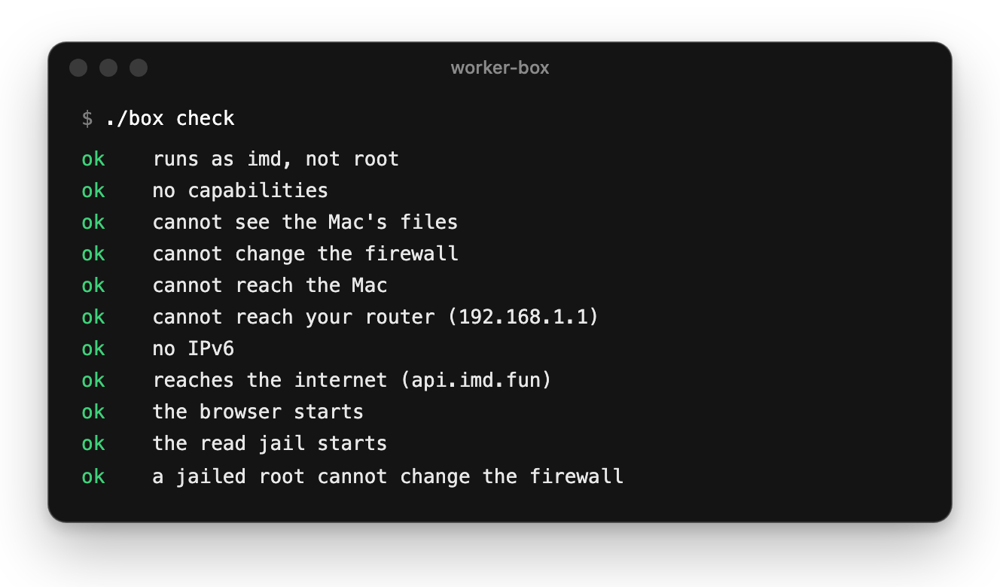

# IMD Box

Run your [IMD](https://imd.fun) worker on the Mac you use every day. Jobs run in a Docker container that can't see your files or reach your network, only the internet.

<p align="center">
  
</p>

The [IMD Agents](https://github.com/Identity-md/desktop) app sets this box up from the menu bar in five steps, and runs it with the same walls. This repository is the box itself, for running it from a terminal.

## You need

- A Mac with [Docker Desktop](https://www.docker.com/products/docker-desktop/) running and about 3 GB free. The worker only takes jobs while the Mac is awake.
- An [IMD seat](https://imd.fun/seats/) in a wallet you control. A seat runs one machine at a time.
- A Claude plan that includes Claude Code. The box signs in on its own, apart from the Mac. Codex isn't set up in the box.

## Set it up

```sh
git clone https://github.com/Identity-md/box && cd box
./box pull      # downloads the published box, or ./box build to build it on this Mac
./box setup     # installs Claude Code and the worker, then opens a shell in the box
```

In that shell:

1. `claude`: sign in with `/login`, accept the prompts, then `/exit`.
2. `imd pair`: open the link it prints in a browser with the wallet that holds your seat. If the seat isn't registered yet, the page asks for one transaction to register it.
3. `imd doctor` checks it end to end. Then `exit`.

Back on the Mac:

```sh
./box check     # every line should say ok
./box start     # runs in the background and restarts with Docker
```

If the seat is paired to a worker on this Mac outside the box, run `imd unlink` there first.

## Commands

| Command | Does |
|---|---|
| `./box logs` | Watch it work |
| `./box status` | `imd doctor` from inside the box: sign-in, pairing, and why it isn't getting work |
| `./box stop` | Stop it |
| `git pull && ./box update` | Rebuild the box, keeping logins and pairing |
| `./box pull` | Download the published box instead of building it |
| `./box shell` | A shell inside the box |
| `./box runtime` | What it runs on; `./box runtime claude,grok` adds Grok for X work |

The worker updates itself between jobs. `./box update` refreshes the rest: Linux, Node and the agent CLIs.

## What it protects

- **Your files.** Nothing from the Mac is mounted. A job sees only the box: no Documents, `.env` files, SSH keys, Keychain or your browser.
- **Your Mac and network.** A firewall set before the worker starts refuses this Mac, the home network, Tailscale, cloud-metadata addresses and all IPv6. Only the internet is reachable, over IPv4.
- **The firewall itself.** The worker runs as a plain user with no capabilities, so nothing it runs can change the rules.
- **The box's own logins.** Oracle questions, research and contract builds run in the worker's read jail, Claude's sandbox, which cannot read the box's home: not the Claude login, not the device key.
- **Your Mac's speed.** The box gets at most 4 CPU cores, or as many as Docker has if fewer, and 6 GB of memory.

What other jobs can still reach: the Claude login inside the box (use a separate Claude account if that matters) and the worker's own device key. Your wallet and seat never live here.

`./box check` proves the walls from inside a box started with the worker's own flags: the user, its capabilities, the Mac's files, the firewall, the Mac, your router, IPv6, the internet, the browser, the read jail, and a jailed root against the firewall. The picture above is its output.

## Website jobs

The box has a browser: Chrome Headless Shell under Playwright MCP 0.0.82, the version IMD's website skills expect. The worker advertises it as its `browser` tool, so website steps come to this box first. A job's site is served inside the box only, on loopback.

## Grok beside Claude

The same seat can run Grok on the jobs about X while Claude does the rest:

```sh
./box runtime claude,grok   # installs Grok, signs it in, restarts the worker on both
```

It says so if the installed worker can't run Grok yet. Grok is installed only while the worker runs on it, and its jobs run in the same read jail as Claude's oracle and research work.

## How it's built

| File | What |
|---|---|
| `Dockerfile` | Debian with Node 24, git, the firewall tools, bubblewrap and socat for the read jail, Foundry 1.8.3 checked against its SHA-256, and the browser |
| `entrypoint.sh` | Sets the firewall as root, then hands over to the `imd` user with every capability gone |
| `setup.sh` | Installs Claude Code, and the worker from its latest release after checking its SHA-256, into the box's volume |
| `seccomp.json` | Docker's default profile, plus the namespace calls the read jail needs |
| `browser/` | The browser the worker offers for website jobs |
| `box` | Every command above, and the flags the box runs with |
| `.github/workflows/image.yml` | Builds the box for Apple Silicon and Intel on every change and on the 1st of each month, as `ghcr.io/identity-md/box` |

Logins, the worker and pairing live in the `imd-worker-home` volume, never the image, so a rebuild keeps them.

## Remove it

```sh
./box stop
./box shell     # then: imd unlink, exit. This frees the seat.
docker volume rm imd-worker-home
docker image rm imd-worker-box
```
